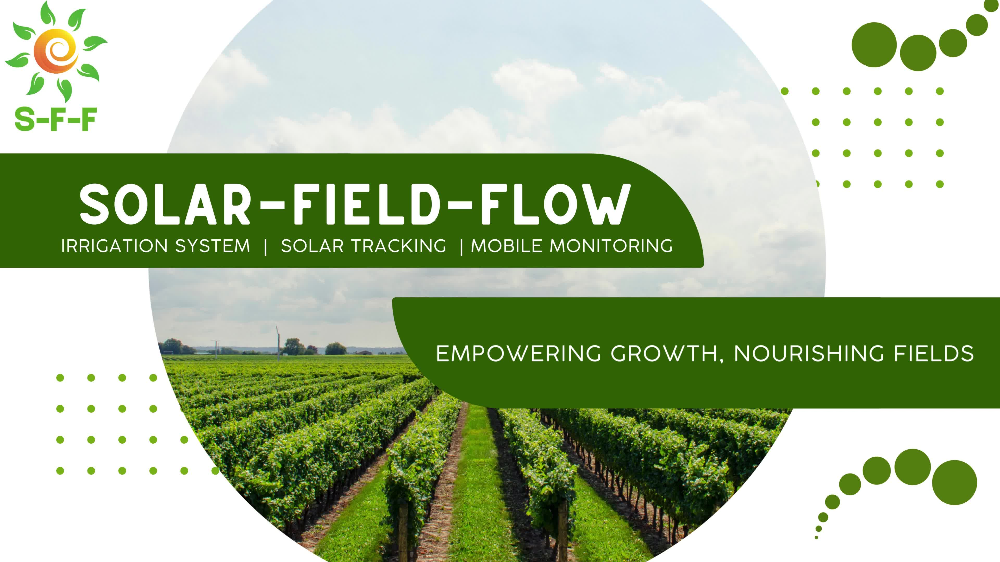
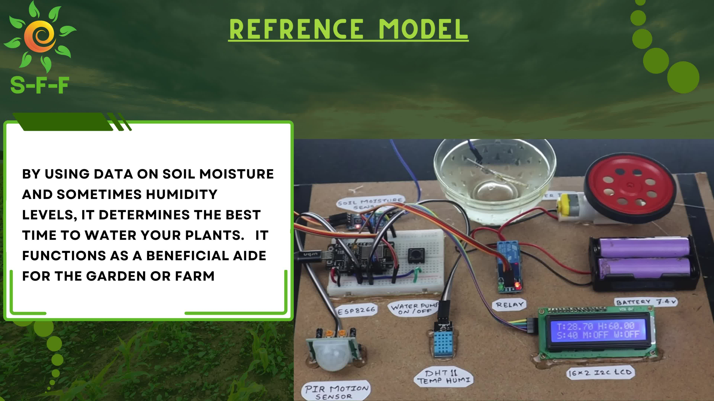

# Solar Field Flow — IoT Smart Irrigation Prototype

Solar Field Flow (SFF) is a student-built smart agriculture prototype focused on soil-moisture monitoring, automated pump control, environmental monitoring and mobile telemetry. The project presentation also describes a solar-tracking concept.

> **Hardware note:** The supplied prototype photograph labels the controller as an **ESP8266**. The integrated Blynk sketch in this repository is therefore prepared for an ESP8266-based board, not an ESP32. Select the exact ESP8266 board variant used in your build when compiling.



## Prototype overview



The prototype photograph visibly identifies an ESP8266 board, soil-moisture sensor, water-pump control/relay, DHT11 temperature-humidity sensor, PIR/motion sensor, 16×2 I²C LCD and a 7.4 V battery pack. The integrated firmware draft labels the D5 digital input as a `fireSensorPin`, while the photograph labels the module as a PIR sensor. Confirm the exact module and its output polarity before wiring or relying on that input.

## Features represented in the integrated firmware

- Read an analogue soil-moisture sensor.
- Convert the raw reading to a percentage using configurable dry/wet calibration values.
- Switch a relay-controlled pump when the calculated moisture percentage falls below the configured threshold.
- Read temperature and humidity from a DHT11 sensor.
- Display soil moisture, temperature, humidity and the digital alert-input state on a 16×2 I²C LCD.
- Publish soil moisture, temperature, humidity and the digital input state to Blynk.
- Activate a buzzer for low soil moisture, high temperature, a DHT11 read failure or a HIGH digital alert input.

## Solar-tracking experiment

A separate single-LDR/servo positioning sketch is included under `experiments/`. It is kept separate from the integrated Blynk firmware because the supplied Blynk sketch attaches an LDR/servo but does not implement servo movement. The experiment moves a servo between two fixed positions based on one digital LDR output. It is a basic positioning experiment, **not a verified dual-LDR solar tracker**, and has not been demonstrated as integrated with the irrigation firmware.

## Hardware documented in the supplied material

- ESP8266 development board
- Soil-moisture sensor
- DHT11 temperature/humidity sensor
- Relay module and water pump
- Buzzer
- Digital alert sensor (photograph labels it PIR; original integrated code labels it fire sensor)
- 16×2 I²C LCD (address `0x27` in the source)
- 7.4 V battery pack shown in the prototype photograph
- LDR and servo for a separate experiment

The exact module variants, power arrangement and complete wiring should be confirmed against the physical build before recreating it.

## Firmware and folder layout

```text
firmware/Solar_Field_Flow/Solar_Field_Flow.ino
firmware/Solar_Field_Flow/secrets.example.h
experiments/LDR_Servo_Position_Test/LDR_Servo_Position_Test.ino
docs/HARDWARE_AND_PINOUT.md
docs/BLYNK_CONFIGURATION.md
docs/DEVELOPMENT_AND_VALIDATION.md
assets/
```

## Software and libraries

Integrated firmware:

- Arduino IDE
- ESP8266 Arduino core
- Blynk library (`BlynkSimpleEsp8266`)
- `LiquidCrystal_I2C`
- `SimpleDHT`

Separate servo experiment:

- ESP8266 Arduino core
- `Servo` library compatible with the selected ESP8266 core

Install the required libraries through Arduino IDE's Library Manager or their maintainers' documented installation instructions. Library APIs can vary by version.

## Configure credentials safely

1. Open `firmware/Solar_Field_Flow/`.
2. Copy `secrets.example.h` and rename the copy to `secrets.h`.
3. Enter your own Blynk template details, device token, Wi-Fi SSID and Wi-Fi password in the local `secrets.h`.
4. Do **not** upload `secrets.h`. It is excluded by `.gitignore`.
5. Open `Solar_Field_Flow.ino` in Arduino IDE and select the exact ESP8266 board used by your prototype.

The example file contains placeholders only. The original archive contained credentials; rotate any previously exposed Blynk device token and Wi-Fi password before using the project again.

## Blynk virtual pins

| Virtual pin | Value |
|---|---|
| `V0` | Soil-moisture percentage |
| `V1` | Temperature in °C (sent when DHT11 read succeeds) |
| `V2` | Relative humidity percentage (sent when DHT11 read succeeds) |
| `V4` | Digital alert-input state |

Configure matching datastreams/widgets in your own Blynk template. The original source did not document a `V3` datastream.

## Calibration and control defaults

The source project used:

- Dry soil ADC reference: `700`
- Wet soil ADC reference: `400`
- Pump threshold: below `20%`
- High-temperature buzzer threshold: `40 °C` or above
- Relay logic: active LOW (LOW = pump relay ON; HIGH = OFF)
- Digital alert logic: HIGH is treated as an alert

These are source-code defaults, not universal calibration values. Recalibrate with your own sensor and verify relay polarity, alert-sensor polarity and safe pump operation before use.

## Safety

- Do not power a pump, motor, servo or other high-current load directly from an ESP8266 GPIO pin.
- Use an appropriately rated driver/relay and a suitable external power supply.
- Check the ESP8266 board's analogue-input voltage limit; board variants differ.
- Ensure compatible logic levels and a common ground where required.
- Keep water away from exposed electronics and mains wiring.
- This is an educational prototype, not a certified agricultural controller or safety/fire-alarm device.

## Project status

This repository is a cleaned, documented portfolio package based on the source files and prototype presentation supplied for review. The firmware has not been confirmed by a fresh compile against the user's exact library versions or by a new physical hardware test in this session. The separate LDR/servo sketch is experimental.

## Author

**Tanzeel Ul Rehman** — Team Lead

GitHub: [@devtanzeel1](https://github.com/devtanzeel1)
